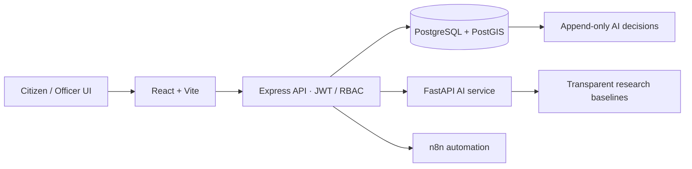

# Civic-Lens AI

**AI-Powered Multilingual Civic Complaint Intelligence and Resolution System**

Civic-Lens AI is an AI intelligence and accountability layer over complaint workflows. It is **not a better complaint portal** and is not intended to replace existing services such as the Pakistan Citizen's Portal. It assists the workflow:

`Understand → Extract → Classify → Prioritize → Route → Detect Related Issues → Monitor SLA → Escalate → Verify Resolution → Audit AI Decisions`

AI outputs are recommendations and estimates, not certainty. Authorized staff retain decision-making authority. An officer's resolution submission does not close a case; the citizen must confirm it or reject it.

## Architecture



## Quick start

Requirements: Docker Desktop with Compose, and (for local dataset/evaluation scripts) Python 3.10+.

1. Copy `.env.example` to `.env` and replace the local secrets. Defaults exist for a local demonstration only.
2. Install AI/evaluation dependencies in a virtual environment:
   ```powershell
   python -m venv .venv
   .venv\Scripts\Activate.ps1
   python -m pip install -r ai-service/requirements.txt
   ```
3. Generate synthetic data if you want to load demonstration records:
   ```powershell
   python data/scripts/generate_synthetic.py
   python data/scripts/validate_dataset.py
   ```
4. Build and start the five local services:
   ```powershell
   docker compose up --build
   ```
5. Open the UI at <http://localhost:5173>, backend OpenAPI at <http://localhost:3000/docs>, AI OpenAPI at <http://localhost:8000/docs>, and n8n at <http://localhost:5678>.
6. In another terminal, optionally seed demo accounts and synthetic complaints:
   ```powershell
   docker compose exec backend npm run seed
   ```
7. With services running and seeded database available, run the end-to-end intake smoke flow:
   ```powershell
   python scripts/smoke_test.py
   ```

Seeded local-only accounts use `citizen@example.local`, `officer@example.local`, `supervisor@example.local`, or `admin@example.local`, with password `LocalDemo-Only-ChangeMe!`. Change these before use beyond a disposable local environment. The backend offers citizen registration at `POST /api/auth/register`; privileged roles must be provisioned by an administrator.

### Research scripts

The generator creates `data/synthetic/SYNTHETIC_complaints.csv` (2,000 records, explicitly synthetic). Then run:

```powershell
python data/scripts/validate_dataset.py
python data/scripts/make_splits.py
python ai-service/training/train_classifier.py
python ai-service/evaluation/evaluate_classification.py
python ai-service/evaluation/evaluate_duplicates.py
python -m pytest ai-service/tests
```

Reports are generated under `ai-service/evaluation/reports/`; model registry metrics are written to `ai-service/app/models/model_registry.json`. Do not quote results until these scripts have been run and the generated reports inspected. Splits group all records by duplicate group to reduce leakage.

## Folder guide

- `frontend/`: React/Vite UI scaffold, English/Urdu direction switching, shared AI components.
- `backend/`: Express API, PostGIS schema, JWT/RBAC, complaint lifecycle, evidence upload checks, AI audit records.
- `ai-service/`: independent FastAPI research service with multilingual rule baselines and evaluation endpoints.
- `data/`: clearly labeled generated data, schema, validation, and leakage-aware splitting.
- `automation/n8n/`: importable local webhook examples; notification delivery requires operator configuration.
- `docs/`: requirements, research framing, evaluation, privacy, and audit guidance.

## Research status and limitations

- The runtime AI is a transparent keyword/rule baseline, **not** a trained or validated production model. Categories and language identification can be wrong.
- There is no included representative Pakistani civic dataset. Synthetic records are for pipeline and code-path testing only; scores on them do not demonstrate real-world performance.
- The duplicate and clustering methods are lexical baselines, not multilingual sentence embeddings. Cross-language semantic duplicate detection is not established.
- Roman Urdu spelling variation, transliteration, code-switching, class imbalance, and underrepresented languages may create systematic errors.
- SLA estimates are experimental transparent rules, not a historically trained predictor; seeded resolution times are synthetic.
- There is no integration with government systems or external complaint portals.
- AI and photos cannot prove that a physical repair occurred. Citizen confirmation is an accountability step, not automated proof.
- The web UI is a functional route/component scaffold, not the final dashboard design. Supervisor/admin analytics and several advanced workflows remain limited.

See [docs/01-project-overview.md](docs/01-project-overview.md) and [docs/08-ethics-privacy-limitations.md](docs/08-ethics-privacy-limitations.md) for scope and limitations.
