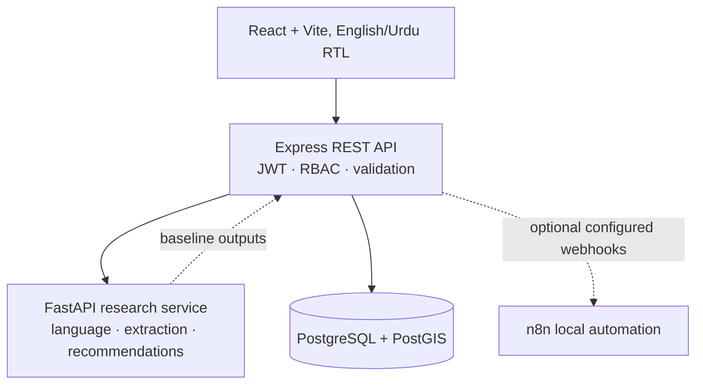
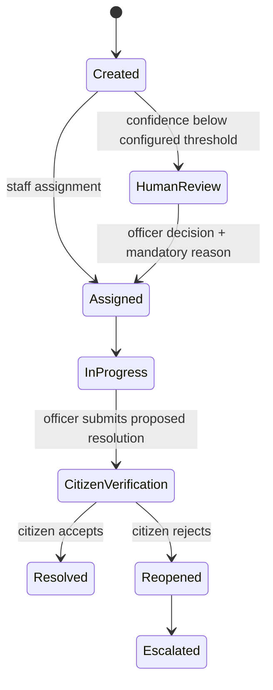

# 03 · Architecture

## Components

## Complaint lifecycle

`Resolved` is reached only after citizen acceptance. The original text is stored in `complaints.original_text`; normalization is a separate field. Each AI assessment and subsequent human correction is represented as an append-only `ai_decisions` record.

## Runtime services

Compose starts PostGIS, the Node backend, the Python AI service, the frontend, and n8n. The backend owns workflow state and persistence. The AI service is stateless and independent from backend implementation. The n8n files are importable workflow templates; a deployment operator must configure credentials, recipient rules, and event triggers.

## Data flow

1. Citizen posts text and optional JPEG/PNG/WebP evidence. Backend validates size/count/type and preserves submitted text.
2. Backend calls FastAPI `/analyze`; the result is a recommendation with version labels and a low-confidence review flag.
3. Backend saves complaint state, status history, SLA deadline, media references, and an AI audit snapshot in a SQL transaction.
4. Officer may accept or override recommendations with a required reason. The correction creates another audit record rather than overwriting the earlier record.
5. Officer resolution submission moves the case to citizen verification; citizen acceptance closes it, rejection reopens and escalates it.
